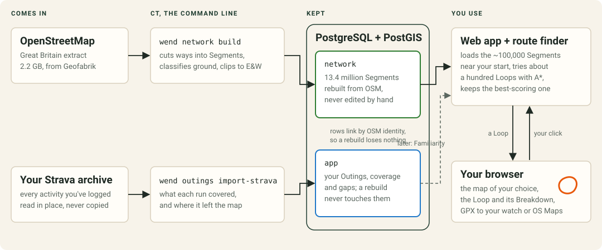

# Wend Your Way

> Generates running, gravel-riding and trail-riding loops, and point-to-point routes, that get off the beaten track by stitching together footpaths, alleys and cut-throughs, and joining them up safely.

[](LICENSE)

## Why

Mainstream route planners are built for getting from A to B or following popular routes. They won't find the obscure alleys, permissive park paths and forgotten footpaths that make a run interesting. They don't handle the hard part, which is linking those paths with quiet streets and safe road crossings. And they don't know where you've already been, so you keep rerunning the same few loops.

Wend Your Way generates Loops from a start point and a distance. It favours Off-road and green ground and long unbroken stretches (Flow), keeps time on roads with traffic (Exposure) and dangerous Crossings to a minimum, and, as strongly as you ask, steers you onto ground your Strava history says you've never covered. Every Loop comes with a Breakdown explaining why it scored as it did. It's a personal tool for one runner and gravel cyclist in England and Wales, running entirely on a laptop at no cost.

## Getting started

Wend Your Way runs on your own computer: nothing is hosted, and your runs never leave it. It plans in
**England and Wales**, on the map of whatever region you build: a county takes minutes, the whole of
Great Britain about an hour.

**What you need**

- A computer with **8 GB of memory** for a county, **16 GB** for England and Wales; about **2 GB of disk**
  for a county, **40 GB** for Great Britain.
- A free **Thunderforest** hobby key for the map's tiles: <https://www.thunderforest.com/pricing/>.
- Optional: **OS Terrain 50** (free from the [OS Data Hub](https://osdatahub.os.uk/downloads/open/Terrain50),
  ASCII grid) for climbing and the Hills slider, and **OS Open Names** (free, CSV) for searching places and
  postcodes. Without them, Loops still plan; they just don't know about hills or names.

Then one of two ways in. Either way, **try it first on the practice map**: a small map of Richmond Park
and around that comes with the app and is ready in seconds, so you can plan Loops (and take the first-Loop
tour) before building your own region. It has a database of its own: nothing done there touches your own
map or runs, and it's emptied each time it opens. With Docker, `docker compose --profile practice up -d practice`
opens it on <http://127.0.0.1:5020>; on Windows, **Switch to the practice map** in the Help panel (and **Back to my
map** there), or `dotnet run -c Release --project src/WendYourWay.Cli -- practice` then the planner with
`--Practice=true`.

### With Docker (Windows, macOS or Linux)

With [Docker](https://docs.docker.com/get-docker/) installed, from this folder:

```sh
cp .env.example .env            # then put your Thunderforest key in it (and, if you like, a Home)
docker compose up -d            # PostgreSQL with PostGIS, and the planner on http://127.0.0.1:5018

# once: the byways for Trail Rides (about 10 MB from rowmaps.com), then your region's map
docker compose run --rm wend byways get
docker compose run --rm wend network regions            # the regions to choose from
docker compose run --rm wend network build --region surrey
```

Then open <http://127.0.0.1:5018>. It's on this computer only. Optional data goes in by mounting its
folder, e.g. `docker compose run --rm -v ./opname:/opname wend places import /opname`. Your runs:
`docker compose run --rm -v ./export.zip:/export.zip wend outings import-strava /export.zip`.
`docker compose down` stops it; your map and runs stay in Docker's volumes.

### On Windows, without Docker

```powershell
# once, from an administrator PowerShell: .NET 10 SDK, PostgreSQL 17 + PostGIS, osm2pgsql
powershell -ExecutionPolicy Bypass -File .\scripts\setup.ps1

# once: the byways for Trail Rides, then your region's map (wend network regions lists them)
dotnet run -c Release --project src/WendYourWay.Cli -- byways get
dotnet run -c Release --project src/WendYourWay.Cli -- network build --region surrey

# the map keys can be added, changed and deleted in the Admin panel's API keys instead (kept in your database,
# never in git or the backups); a key saved there wins over one set here
# once: the Thunderforest key, and where Requests start until you click elsewhere (kept out of git)
dotnet user-secrets set Thunderforest:ApiKey <key> --project src/WendYourWay.Web
dotnet user-secrets set Home:Latitude <latitude> --project src/WendYourWay.Web
dotnet user-secrets set Home:Longitude <longitude> --project src/WendYourWay.Web
# optional: an Ordnance Survey key (free OS Data Hub plan) adds OS Outdoor to the map switcher
dotnet user-secrets set OsMaps:ApiKey <key> --project src/WendYourWay.Web
# optional: on OS Data Hub's Premium plan, OS Outdoor is drawn to zoom 20 (the free plan stops at 16), and OS Explorer is offered
dotnet user-secrets set OsMaps:Premium true --project src/WendYourWay.Web

# optional: place names and postcodes for the search box, from OS Open Names (unzipped; read in place)
dotnet run -c Release --project src/WendYourWay.Cli -- places import <path to opname_csv_gb>

# your own runs: a Strava bulk export, or loose GPX, TCX or FIT files (or later, from the app's Admin panel)
dotnet run -c Release --project src/WendYourWay.Cli -- outings import-strava <your Strava export.zip>
dotnet run -c Release --project src/WendYourWay.Cli -- outings import-gpx <folder>

# once: the launcher, and its Wend Your Way shortcuts in the Start menu and on the desktop
# (right-click the Start menu one, Pin to taskbar)
dotnet build -c Release src/WendYourWay.Launcher
src\WendYourWay.Launcher\bin\Release\net10.0-windows\WendYourWay.Launcher.exe --install

# or start the planner by hand on http://127.0.0.1:5018 (this computer only), built Release:
# a Debug build finds long Loops at half the speed
dotnet run -c Release --project src/WendYourWay.Web
```

If you'll change the code: `git config core.hooksPath .githooks` once, so a commit carrying your Home's
coordinates or your map key is refused.
**Opening it:** click the Wend Your Way icon. Its starting window says each step; if the code has
changed since it was last built, it rebuilds the app and `wend` first (about a minute; if that fails, the
last build that worked opens). The planner opens in a window of its own (WebView2, Edge's engine, part
of Windows 11); links away from the app open in your browser. Clicked again, the open window comes to
the front. Closing the window stops the app, after any backup under way; a map update, import, restore
or change of map carries on to the end, shown across the top of the planner while it runs, and keeps
the laptop from sleeping meanwhile. Its words go to `data/logs/launcher-<date>.log` and
`app-<date-time>.log`. Anything after `--` goes to the app, for trying it by hand:
`WendYourWay.Launcher.exe -- --urls http://127.0.0.1:5019 --Home:Latitude=… --Home:Longitude=…`.

## Usage

**Today:**

- **The first-Loop tour**, offered the first time it opens and in Help any time, has you plan your first Loop a step at a time: choose a start, change the Distance and press Go, page through the Loops, open the Breakdown (or press Explain?), Nudge it, and save or export it. Each step moves on when you do it; any can be skipped.
- **Choose a start** by clicking the map, choosing one of the car parks around the part of the map in view, or searching for a postcode. Loops are found at once. Searching for a place name ("Box Hill", "Epping Forest", "EN4") takes the map there instead, to see its car parks.
- **Car parks around here** lists the best ten places to park beside large Off-road networks for your Distance, with Loop 1 from the first five worked out to compare ("10.6 km · 97% green · 121 m up"). Every one in view is marked P on the map; turn them off, like the cafés and toilets, in the map's layers button.
- **Distance** from 1 to 100 km, with Go beside it. The **Hills** and **Off-road** sliders re-rank the Loops as you drag them.
- **Up to five Loops**, best first, to page through with the arrows on the Loop card (which you can drag anywhere, and double-click to put back in the middle). The eye on the card hides the route, to see the paths and roads under it, and shows it again. **Explain?** says on the map why the route goes the way it does: its Crossings and their kind, its gates, stiles and other Obstacles, its longer stretches of road (and how much is beside or on a Main Road), and its longest green stretch, in the Breakdown's own figures; zoomed out just the stretches, zoomed in each Crossing and Obstacle too. It follows the route as it's nudged or paged, and stays on till it's pressed again. **Nudge** a Loop: drag its line to where it should go, or click it and choose *Avoid this*; only the stretch round it changes. Avoided bits are marked "!"; click one, or a numbered stop, to remove it. **Undo** and **Redo** (Ctrl+Z, Ctrl+Y) step back and forward through every change, a new start included, so a stray click on the map costs nothing. Clicking the route offers **Avoid this time**, for this Loop only, and **Never use this**, which keeps that stretch off every Loop from then on (drawn red; click it to unblock), and **Fix the map here** and **Report a problem here**, which open OpenStreetMap's own editor or note form at that spot. Opened, it shows the Breakdown (length, climbing, Off-road, Traffic-free, longest green stretch, Main Road, Greenery, Waterside, Crossings) and an elevation profile.
- **Ways for customers only** (a garden centre's, a golf club's, a pub garden's, or a public path tagged so by mistake) are used, as OpenStreetMap's tagging of them is too often wrong to rule them out, but cost a little more; where a Loop runs on one its line is striped white, the key says *check you may pass*, and Explain? notes it.
- **Save** a Loop with the bookmark on the card, nudged or not: **Saved Routes** in the side panel lists them, to open on the map again, rename or delete.
- **Import GPX** under Saved Routes shows a route from elsewhere (a friend's, another planner's) on the map like a Loop: matched onto the paths for the Activity chosen, point to point if it doesn't come back to its start, with any stretch off the map in red. Nudge it, export it, or save it under its own name. The file is read on your machine; nothing is sent anywhere. An Outing can be made a route the same way: **To route** under the Outing shown.
- **Export GPX** and follow it in the OS Maps app, or **TCX** for a watch: both mark each turn worth saying ("Left onto Bush Road", "Right onto the footpath"); in the GPX each is put a little before its turn (about 30 m on a Run, 50 m on a ride, less where turns come close together), so an app that speaks it as you reach it says it in time, and are named as the route is: a Saved Route by its name, an Outing made a route by the Outing's, a new Loop by its place and length ("Kenwood House · 9.7 km", file `kenwood-house-9.7km.gpx`). **QR** on the Loop card sends it to your phone over your Wi-Fi: scan the code, and the GPX downloads (one download, for ten minutes; the app itself stays on the laptop). Open it in Footpath, OS Maps or Komoot. Your settings are remembered for next time.
- **Stars:** the Outings list and Saved Routes show the app's stars for each (one to five: a Run's as Loops are ranked, its score with what off-road ground and climbing add, banded to match how you rate, the lowest tenth of your Runs 1 star and the top 30% 5 stars; a ride's a fifth of your rides each) beside your own, which you give with a click. Where you and the app are two stars or more apart, it stands out. **GPX** under the Outing shown downloads its own track, to overlay in OpenStreetMap's editor where it left the map. **Rename** gives it a better name (kept through a re-import, and used when it's made a route and exported). **Delete** (asked first) removes an Outing you don't want, a duplicate say: it stops counting as ground you've covered, and no later Strava export or GPX import brings it back; the next in the list is shown, to go through them quickly. Above the list, **All**, **★5**, **★4–5** and **Not rated** filter the Outings by your own stars, and a name box finds any by part of its name.
- **A key to the map**, bottom right: what each colour and mark on screen means (the Loop and its stops and gaps, Blocked stretches, an Outing's ground, and each overlay that's on, Signed trails by level), changing as overlays go on and off; one that's on but not drawn at this zoom says *zoom in to see*, and one whose service is down or doesn't answer within 30 seconds says *couldn't load just now* (asked again as the map moves). Click **Key** to fold it away; that's remembered.
- **Off-road networks** layer (map switcher) shows where the good green ground is.
- **Aerial photos** and **Signed trails** (map switcher): whether a path is a real track, and the waymarked walking, cycling and MTB routes. Rest the pointer on a signed route for its name, code and links (Waymarked Trails, OpenStreetMap, its website), from your own map data.
- **Open access land** (map switcher): CRoW access land, where you may go off the paths: England's from Natural England (from zoom 11), Wales's from Natural Resources Wales (from zoom 12).
- **Gaps in OSM** (map switcher): the short gaps the map build found, from zoom 14: a path that stops short of another way with nothing mapped across, under 5 m (yellow, Loops cross it) or 5 m to 15 m (grey). Click one for its length and links to the two ways and OpenStreetMap's editor there, to see what the problem is; fixed in OSM, it's gone after the next map update.
- **OS Explorer** (map switcher, on OS Data Hub's Premium plan): OS's Leisure map, the Explorer-style 1:25 000 at zooms 14–16 (OS's smaller scales further out), drawn to zoom 17. OS serves it on Britain's own grid only, so the map switches grid while it's chosen, keeping the Loop, the view and everything else in place; Off-road networks, Signed trails and OS paths are cut on the web grid (OS paths are vector tiles, drawn by MapLibre, which works on that grid alone) and aren't drawn over it (the switcher says so) and come back with any other map.
- **OS paths** (map switcher, on OS Data Hub's Premium plan, with the OS NGD API – Tiles added to the key's project): Ordnance Survey's paths in magenta from zoom 17, to spot those OpenStreetMap lacks.

**Planned:** a Heading control, Novelty (unfamiliar ground), car park details (fees, closing times).

## Commands and settings

`wend` is the command line: `dotnet run -c Release --project src/WendYourWay.Cli -- <command>` (Release: about twice as fast as a Debug build on a long job). Every command takes `--database <connection string>`; without it, the app's own database: `Host=localhost;Port=5432;Database=cutthrough;Username=cutthrough` (the password from your PostgreSQL password file, never stored here). Ctrl+C stops any of them cleanly: a build leaves the Network as it was, an import or scoring keeps what it finished.

| Command | What it does | Options |
|---|---|---|
| `wend network build <extract>` | Loads an OpenStreetMap extract (Geofabrik `.osm.pbf`, or `.osm` XML) with osm2pgsql, then builds the Network from it: Segments, ground, same ground, Open ground, Off-road networks, Trailheads, Obstacles, Gravel hotspots, climbing, Access for each Activity, Outings covered again and scored. The app keeps running on the old Network until the new one is swapped in. | `--osm2pgsql <path>` (default: `WEND_OSM2PGSQL`, or the copy in `tools/osm2pgsql`); `--terrain <folder>` (OS Terrain 50 tiles, default `data/terrain50/asc`; without them, no climbing); `--rights-of-way <folder>` (the Definitive Map byways, default `data/rights-of-way`; the build stops without them) |
| `wend network build --region <region>` | Downloads a region of England or Wales from Geofabrik (a county, say `surrey`, or `wales`), checked against its MD5, and builds the Network from it, as `wend network build` does from a file. Refused outside England and Wales; a name not quite right gets the nearest suggested. | `--data <folder>` (default `data`), `--terrain`, `--rights-of-way` |
| `wend network regions` | Lists the regions of England and Wales Geofabrik publishes, to choose one. | |
| `wend network rebuild` | The same build from the extract already loaded, without osm2pgsql: after a rule changes, or new terrain or byways. | `--terrain`, `--rights-of-way` as above |
| `wend update` | Brings the map up to date in one go: if Geofabrik's Great Britain extract is newer than the map, downloads it (checked against its MD5; the one before kept as `great-britain-prev.osm.pbf`), builds the Network from it, scores and calibrates the stars, and backs up. OS Terrain 50 (heights, before the build) and OS Open Names (place names, after it) come with it when OS has a newer release, from OS's Downloads API: kept in `data/terrain50` and `data/opennames`; if OS can't be reached, those in use are kept. Whatever fails part-way, the map in use stays as it was; a run stopped after its map was built is finished by the next. One at a time (a build by hand waits its turn too). | `--log <file>`: what it says, to a file as well; `--source <url>`: another extract like Geofabrik's; `--terrain <folder>`: OS Terrain 50's tiles (default `data/terrain50/asc`) |
| `wend network back` | Goes back to the map before (each build keeps the one before it), if a new map turns out bad; run again, it goes forward again. The Outings are covered and scored again on it, Saved Routes the map changed under are moved onto it, and the stars calibrated. Refused if there's no map before, or it was made by an older Wend Your Way. What **Go back to the map of …** in the Admin panel runs, after asking. | `--terrain`, `--log <file>` |
| `wend network offroad` | Finds the Off-road networks, Trailheads, Obstacles and Gravel hotspots again on the Network as it is, in minutes, without a rebuild. | |
| `wend outings import-strava <export.zip>` | Imports your whole history from Strava's bulk export, read in place: runs, walks, hikes and rides (swims and trainer rides skipped); works out what each covered, its gaps, and scores it. Importing a newer export adds only what's new. | |
| `wend outings import-gpx <file-or-folder>` | The same for loose GPX, TCX or FIT files (gzipped too). | |
| `wend routes move` | Moves each Saved Route the map has changed under (an OSM way split or joined since it was saved) onto the map as it is, if it still follows the same line, so it can be nudged again; its name, date and your stars kept. One whose path has gone is kept as it was, saying where. `wend update` does this after it builds, and **Move to the new map** in Saved Routes does it for one. | |
| `wend outings import-downloads` | What **Import runs from Downloads** in the app's Admin panel runs: the newest Strava export in Downloads (`export_*.zip`) and every GPX, TCX or FIT there you recorded (from Footpath or any other app). Planned routes (Wend Your Way's own exports among them), ones already in and ones you deleted are skipped, and it says how many of each. Calibrates if anything came in, then backs up. | `--folder <folder>`: another folder; `--log <file>` |
| `wend outings score` | Scores the Outings not scored yet, for the app's stars (a rebuild and every import do this themselves), and any Saved Route saved before the stars (as a Run). | `--all`: every Outing again, after a scoring rule changes |
| `wend outings calibrate` | Works out again where the stars are cut, from your Outings as they are (a Run's at the 10th, 30th, 50th and 70th percentiles of its ranking value, a ride's at fifths of its score), and keeps them with your data. Says the cuts before and after, and how many of the Outings you've rated the stars match. Run it after a rescore or a big import; the lists show the new stars when next opened. | |
| `wend places import <folder>` | Loads OS Open Names (its CSV download for Great Britain, unzipped), in place of what was there, for searching by place name and postcode. | |
| `wend backup [folder]` | Backs up your own data (Outings, stars, Saved Routes, Marks, settings) to `wend-your-way-<date-time>.dump`, with a `.json` beside it saying when, which version of the database, and how many rows. 10 are kept, spread over a month (the newest 3, then one a day, then one a week). Imports, scoring and builds back up by themselves when they finish, and the app does when it starts if the last backup is a day old. | The folder: the one given, else `WEND_BACKUP_FOLDER`, else "Wend Your Way Backups" in your OneDrive. Another database than the app's own (London's, say) gets a folder of its own inside it; a `*_test` database is never backed up by itself. |
| `wend restore <backup.dump>` | Puts a backup's data back in place of what's there, after backing up what's there first; refuses one from a newer Wend Your Way. Reports each table's rows, backed up and restored, and fails if any differ. Run as a job: it waits its turn if another (an update, an import) is running. The Admin panel lists the last ten backups and restores one, asking first, and has "Back up now". | `--log <file>` also writes what it says to a file. |

The planner, `dotnet run -c Release --project src/WendYourWay.Web`, reads these settings: from `dotnet user-secrets` (kept out of git), or on its command line as `--Name=value`, which wins. The map keys (`Thunderforest:ApiKey`, `OsMaps:ApiKey`, `OsMaps:Premium`) can also be saved in the Admin panel's **API keys**, which lists each one, what it gives and where to get one; a key saved there wins over these, is kept in your database, and is never backed up.

| Setting | What it is |
|---|---|
| `Home:Latitude`, `Home:Longitude` | Where Requests start until you click elsewhere. Kept in user-secrets; never committed. |
| `Thunderforest:ApiKey` | The Thunderforest map key (free hobby key from thunderforest.com): the Outdoors and OpenCycleMap pictures. |
| `OsMaps:ApiKey` | Optional: an Ordnance Survey key (OS Data Hub's free plan) adds OS Outdoor to the map switcher. |
| `OsMaps:Premium` | Optional: `true` on OS Data Hub's Premium plan draws OS Outdoor to zoom 20, within its free monthly allowance; otherwise it stops at 16, the free plan's limit, and is enlarged. It also offers OS Explorer (OS's Leisure map, on Britain's grid) and OS paths, from OS NGD's vector tiles (add the OS NGD API – Tiles to the key's project). |
| `Terrain:Folder` | OS Terrain 50 tiles for elevation profiles, if not in `data/terrain50/asc`. |
| `ConnectionStrings:WendYourWay` | Another database: London's, say, `Host=localhost;Port=5432;Database=cutthrough_london;Username=cutthrough`. |
| `Backup:Folder` | Where the app's own daily backup goes, if not "Wend Your Way Backups" in your OneDrive. |
| `--urls` | Where it listens: `http://127.0.0.1:5018`, this laptop only. The QR code for your phone uses a listener of its own on your Wi-Fi, for ten minutes, never the app itself. |

## Keeping the data fresh

Your own data (Outings, stars, Saved Routes, Marks, settings) lives apart from the map and is linked to it by OpenStreetMap's own ids, so refreshing any of these never loses it.

| Data | How often it changes | To refresh |
|---|---|---|
| **OpenStreetMap** (paths, roads, parks, car parks) | Every day: Geofabrik publishes a fresh extract nightly. Monthly or after you've fixed something in OSM is plenty. **Update the map** at the foot of the Request panel (it shows when Geofabrik has a newer map: "A newer map is available: …"), or `wend update`, which does all of this when Geofabrik's map is newer: downloads `great-britain-latest.osm.pbf` (about 2 GB) into `data/` and builds from it. By hand, `wend network build data/great-britain-latest.osm.pbf`. Great Britain: about 30 minutes to load, then about 4 hours to build (climbing about 1 hour, scoring your Outings about 25 minutes), best overnight in your own terminal. |
| **Definitive Map byways** (Trail Rides) | When a council publishes a new Definitive Map: a few times a year at most. | `powershell -ExecutionPolicy Bypass -File .\scripts\get-rights-of-way.ps1` (downloads only what changed), then `wend network rebuild`. |
| **OS Open Names** (search) | Quarterly. | Comes with **Update the map** when OS has a newer release (about 100 MB): the Admin panel says which is in use. By hand: download the CSV for Great Britain from osdatahub.os.uk, unzip it, `wend places import <folder>`. |
| **OS Terrain 50** (climbing) | Once a year, in July. | Comes with **Update the map** when OS has a newer release (about 160 MB), before the build climbs on it: the Admin panel says which is in use. By hand: unzip the new ASCII grid tiles into `data/terrain50/asc`, then `wend network rebuild`. |
| **Your runs** | Whenever you like. | Request a new bulk export from Strava (Settings, My Account, Download or Delete Your Account), then **Import runs from Downloads** in the Admin panel (or `wend outings import-strava <export.zip>`): only new Outings are added, covered and scored. Files from other apps in Downloads come in with it. |

**Your own data** is backed up by itself to OneDrive (see `wend backup`); on a new laptop, set up Wend Your Way, then restore the newest backup from the Admin panel (or `wend restore` it).

The button starts the built `wend` (build it once with `dotnet build -c Release src/WendYourWay.Cli`, and again after pulling new code: the panel says when it's needed) in a process of its own, with its words in `data/logs/`; closing the app doesn't stop it, and the panel shows its stage while it runs and how it ended.

The foot of the Request panel says how recent the Network's paths are ("Paths from OpenStreetMap as of 19 Nov 2026.") and whether Geofabrik has anything newer ("Up to date: Geofabrik's latest is 19 Nov 2026."): the extract's own date, kept by the build. The map's tiles come from OpenStreetMap as it is now, so a path added since can show on the map before a Loop can use it; a newer extract and `wend network build` bring it in.

After a change to a rule rather than the data, `wend network rebuild` is enough (no osm2pgsql); after a change only to how car parks or Off-road networks are found, `wend network offroad`; after a change to scoring, `wend outings score --all`, then `wend outings calibrate`.

## How it works



Two pipelines fill one database, and the planner reads from it:

- **`wend network build`** loads an OpenStreetMap extract with osm2pgsql and cuts it into a Network of Segments (the stretch of a way between two junctions). It labels each one Off-road, Traffic-free or Connector, finds pavements running beside roads (same ground), and keeps only England and Wales. Great Britain is 13.4 million Segments, built on the laptop in about two hours. **`wend network rebuild`** remakes the Network from what's already loaded, without osm2pgsql, when a rule changes; each Segment's Greenery (how much of it lies beside park, wood, common or water) and Corridor (the named walking route or national cycle route it's on, such as the Capital Ring) are worked out as it's built.
- **`wend places import`** loads OS Open Names (places and postcodes for England and Wales) for the search box, which answers on the laptop.
- **`wend outings import-strava`** reads your Strava export and works out which Segments each run covered, and where it left the map (gaps). Each Outing is then matched onto the Network and scored as a Loop is, for the app's one to five stars beside it (see Stars above); **`wend outings score`** scores any not scored yet.
- **The planner** loads the Segments near a Request's start into memory, and our own A\* router builds candidate Loops using the same cost function that scores them, so generation optimises exactly what the Breakdown measures. A Blazor Server page on localhost shows the result over Thunderforest Outdoors map tiles. The build also joins green ground into Off-road networks and keeps the public car parks beside the large ones (Trailheads), which the planner lists for whatever part of the map is in view.

The map, the place names and your history live in separate schemas (`network`, `places` and `app`), linked by OSM identity rather than database keys, so rebuilding the map never touches your data. Greenery, Corridors, Open ground, climbing (from OS Terrain 50) and Access (who may use each way: a Run, a Gravel Ride, a Trail Ride) are built; Hazard and Obscurity are designed but not built yet.

**Built on:** C# on .NET 10, Blazor Server, PostgreSQL 17 + PostGIS 3.6, osm2pgsql 2.3, Npgsql and DbUp, Garmin's FIT SDK, Leaflet 1.9 with a choice of map tiles (Thunderforest Outdoors and OpenCycleMap, Ordnance Survey's Outdoor style, CyclOSM, OpenTopoMap, Esri's aerial photos, Waymarked Trails' signed trails, and open access land from Natural England and Natural Resources Wales: the only online services, switched on the map), and OpenStreetMap data from Geofabrik. Tests: NUnit and bUnit. No routing engine: costs change with every Request, which precomputed routers can't follow.

The app has the same explanation at `/how-it-works` (from the Help panel). See [docs/ARCHITECTURE.md](docs/ARCHITECTURE.md) for depth, and [CONTEXT.md](CONTEXT.md) for the vocabulary.

## Status

**Pre-alpha.** The architecture, behavioural spec, ADRs and how it works are in [`docs/`](docs/), the glossary in [CONTEXT.md](CONTEXT.md); the stories and tasks, done and to do, are in [GitHub Issues](https://github.com/DamianCannon/wend-your-way/issues). The project was called CutThrough until November 2026.

- Done: a walking skeleton from a Request to a GPX (Slice 1); your own runs overlaid on the Network, with coverage and gaps (Slice 2); Great Britain built on the laptop and clipped to England and Wales; real scoring (Flow, Greenery, Corridors, Main Roads, Crossings, climbing), Open ground, five Loops with Lean sliders; finding where to start (Off-road networks, car parks around here, comparing them); place and postcode search.
- Then: Gravel and Trail Rides (byways from the highway authorities' Definitive Maps); point-to-point routes; Saved Routes, Marks and nudging; routes imported from GPX and made from your Outings; the app's stars and your own; routes to your phone by QR code, turn points, and a TCX for a watch.
- Then: backing up and restoring your own data, to OneDrive, by itself.
- Then: a Saved Route whose map has changed says so.
- Then: Runs ranked as your stars weigh them: the score, plus how much of a Loop is off-road and how much it climbs (fitted to your rated Runs).
- Next: a way for others to set it up.

## Contributing

See [CONTRIBUTING.md](CONTRIBUTING.md).

## Security

See [SECURITY.md](SECURITY.md).

## License

MIT. See [LICENSE](LICENSE). Map data © OpenStreetMap contributors (ODbL); map tiles © Thunderforest. Contains OS data © Crown copyright and database right 2026 (OS Terrain 50, OS Open Names); rights of way: the highway authorities' open data under the Open Government Licence, via rowmaps.com; Royal Mail data © Royal Mail copyright and database right 2026; National Statistics data © Crown copyright and database right 2026.
