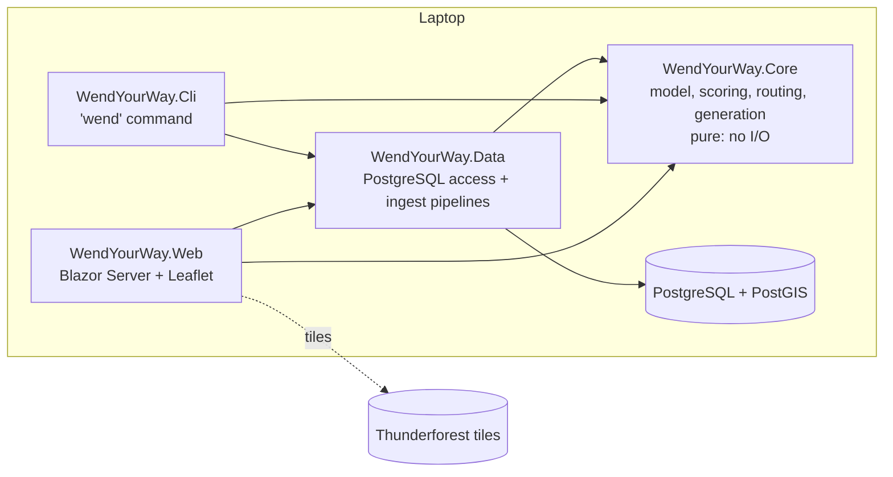

# Architecture

How Wend Your Way is built. The vocabulary is in [CONTEXT.md](../CONTEXT.md), and observable behaviour is in
[SPEC.md](SPEC.md). Every name below uses the glossary's terms.

> **Design for change.** The two things that will change most are **the scoring
> weights** (judged against the user's own ratings for as long as the project
> lives: their stars on Outings and Saved Routes, and their rated Loops) and
> **the Network** (rebuilt whenever OSM is refreshed). The structure is shaped so
> that a weight change is a one-line diff with a fast test, and a Network rebuild
> never touches the user's own data or interrupts using the app.

## At a glance

| Concern | Choice |
|---|---|
| Language / runtime | C# on **.NET 10** (LTS; .NET 8 support ends Nov 2026) |
| UI | **Blazor Server**, bound to localhost, with a small **Leaflet** JavaScript module for the map |
| Basemap | **Thunderforest Outdoors** raster tiles (free hobby key) |
| Database | **PostgreSQL 17 + PostGIS**, accessed with Npgsql (+ NetTopologySuite for geometry), migrations as plain SQL in `db/migrations`, embedded in `WendYourWay.Data` and applied in name order by DbUp |
| Routing | **Our own A\* router, in-process**, over a Network slice held in memory ([ADR 0006](adr/0006-route-in-process-over-network-slices.md)) |
| OSM import | **osm2pgsql** (flex output, Lua style) from the Geofabrik Great Britain extract |
| Elevation | **OS Terrain 50** (OS open data, 50 m grid), its ASCII grid tiles read by the build in C# and sampled per Segment (T049), and by the app for a planned Loop's elevation profile (T051; `Terrain:Folder`, default `data/terrain50/asc`) |
| Coordinates | Stored in **British National Grid (EPSG:27700)**, so lengths and buffers are in metres; converted to WGS84 only at the edges (Leaflet, GPX) |
| Tests | **NUnit**, written test-first with the `tdd` skill, named Feature / Scenario / Specification after the stories |
| Hosting | The user's laptop (16 GB RAM, 8 cores). £0 running costs. Installed natively by `scripts/setup.ps1` (winget); no Docker, no Java |

## Components



| Project | Responsibility |
|---|---|
| `WendYourWay.Core` | The model and everything that judges or builds a Loop: Segment, Loop, Request, Activity, Breakdown, `ScoringWeights`, the **edge cost function**, the **A\* router**, Retrace by same ground, Flow, Exposure, Crossings, distinctness, the Main Road rule, Leans and Heading, and **generation** (anchors, candidates, top-five selection, re-ranking, Nudge repair). Defines the ports `INetworkSlices` and `IUserKnowledge`. **No I/O, no clock, no database.** |
| `WendYourWay.Data` | Implements the ports against PostgreSQL; owns `db/migrations`, the repeatable `db/functions` and the plpgsql Network Build; plans Loops for the screen, finds the car parks in view and compares their Loops, and writes GPX (`Planning/`); searches places (`Places/`); the ingest pipelines (OSM via osm2pgsql, OS Terrain 50, OS Open Names, DfT traffic counts, rowmaps, Strava export). |
| `WendYourWay.Web` | Blazor Server pages: Request, car parks around here, place search, the Loop card with its Breakdown, GPX export and import, Nudges, Saved Routes, Blocked Marks, Outings (filtered by the user's stars and by name, renamed, deleted); later triage. The planner page is a view: its state and what the user does to it are `Planning/PlannerSession`, which draws through `IPlannerMap` (that `MapView` implements) and is built of `PlannerHistory`, `RouteNames`, `SavedNames`, `NudgeNotes` and `StartsAround`, each specced without a page (T124). |
| `WendYourWay.Cli` | `wend`: Network build, rebuild and `network offroad`; Outings import and score; `places import`; `backup`; later setup check. |

Tests: `WendYourWay.Core.Specs` (fast, pure) and `WendYourWay.Integration.Specs`
(`[Category("Integration")]`, needs local PostgreSQL).

The rule of the layout: **Core depends on nothing; everything else depends on
Core.** Scoring, routing and generation can all be tested with no database and
no network connection.

## The key idea: one cost function, used to route and to judge

Every Segment has a **cost per metre** for each Activity, computed in Core from
its attributes (ground class, Greenery, Obscurity, Hazard, surface, Access)
and `ScoringWeights`. Crossings and Obstacles add fixed costs. That same cost
function serves twice:

1. **Routing.** A\* finds the cheapest Path between two consecutive Anchors. A Request adds
   per-request adjustments to the cost:
   - Blocked Marks and Avoids: impassable.
   - Grim and Gem Marks: more and less costly.
   - Ways whose Opening Hours are closed at the time Pace says the user will get there: impassable.
   - Leans: the Greenery, Off-road and Hills terms are multiplied, within
     bounds held in `ScoringWeights`; at a Lean's centre the multiplier is 1.
   - Novelty: Segments in unfamiliar same-ground groups get a discount that
     grows with the Lean (none at zero).
   - When finding a Loop's later Paths, same-ground groups already used by its earlier Paths: a penalty. This avoids Retraces during routing, not just in scoring.
2. **Judging.** A whole Loop's score is its per-km cost turned into quality, plus
   the qualities that only exist at whole-Loop level: Flow (rewarding long
   unbroken stretches), Retrace (with the Stem and Spur rules) and the Main Road
   rule. Distinctness applies across Loops. **The score is per km, so Loops of
   different lengths and places are comparable**, which is what judging them
   against the user's rated routes needs.

Because the router minimises exactly what the scorer measures, generation and
judgement can't drift apart, and calibrating weights from Way Choices (version
1) fits a single set of numbers.

### Network slices

*Measured 2026-10-16 (T006 performance spec, this laptop):* a synthetic slice of
200,344 Segments builds in under 10 ms, and A\* finds 3–8 km Paths in a median
1.3 ms (Release) / 2.0 ms (Debug), worst under 10 ms, with a realistic cost
spread (×1 / ×1.5 / ×3). A Request's few hundred Paths therefore take well under
a second, so generation can afford thousands of candidates.

A Request loads the Segments within (Distance ÷ 2 + a margin) of its start from
PostGIS into a compact in-memory graph: adjacency arrays plus per-Segment
attributes, with no geometry beyond what the map needs. A 10 km London Request
is a circle about 12 km across, about 105,000 Segments (measured: 104,743), which takes
milliseconds per Path for A\*. Slices aren't cached yet: every Request loads its
own (0.65 s for London's 6 km slice). Caching them is a later optimisation. If a long Gravel Ride's slice proves slow to load, `wend network
build` can additionally write a compact routing-graph file. That's an
optimisation behind `INetworkSlices`, not a design change.

### Generating a Request

```
Request ─► snap the start to the nearest junction of the slice's largest usable
           piece, at most 500 m away (planned: never onto a Main Road, never
           across a railway or river)
        ─► load (or reuse) the Network slice around it
        ─► choose anchors: both ends of nearby Corridors, unfamiliar Segments
           (Novelty), Attractions, Vias
        ─► build candidate Anchor sets: start → Anchors → start, on a circle
           sized from the Distance and shifted towards the Heading by its
           strength; correct the radius from the lengths of the first
           candidates (London detours a lot)
        ─► find each candidate's Paths with A* (used same-ground groups
           penalised for later Paths)
        ─► drop candidates outside the Distance window; score the rest per km
        ─► apply the Main Road rule; pick five Loops sharing ≤ 30% ground
        ─► stream: the best five so far go to the UI after every round,
           until the budget (~25 s) runs out or rounds stop improving
```

A Corridor Anchor sits at **both ends** of the Corridor, so the Path between them
runs along it. This is Trail Router's quality lesson, and how Flow gets designed
in rather than hoped for.

### Leans, Heading and instant re-ranking

Every scored candidate is kept for the life of the Request, with the per-quality
totals its score was built from (Off-road, Greenery and climbing per km,
unfamiliar share, Flow, Exposure, Retrace, and its centre-of-mass bearing from
the start). When a Lean or the Heading moves, Core **re-scores the kept
candidates from those totals**. No routing is needed, so the pager updates
while the user drags. A background round then routes new candidates with the
new multipliers and Heading, and merges them in. Bounds on each Lean live in
`ScoringWeights`. The Main Road rule and Access sit outside the Leans, so no
Lean can override them ([ADR 0007](adr/0007-leans-steer-requests-weights-stay-fixed.md)).

The last Request's settings (start, Activity, Distance, Leans, Heading) are
saved in `app.settings.last_request` (jsonb) and restored on load.

**Nudges** reuse the same machinery locally. A Via is inserted between the two
nearest Anchors, and only the two adjacent Paths are re-found. An Avoid makes
that Segment impassable, and only the Path containing it is re-found. The rest
of the Loop is kept, and the whole Loop is re-scored.

## Data flow: building the Network

*Brought up to date in one go (T127):* `wend update` takes an advisory lock that
`wend network build` and `rebuild` take too (one at a time), finishes a run that
stopped after its swap, asks Geofabrik's `state.txt` whether its extract is
newer than the map, downloads it to a `.part` checked against its MD5 (the one
before kept), imports it with osm.import marking the import unfinished till it
is (a rebuild refuses after one that didn't finish), builds as below, then
scores, calibrates and backs up. Each stage and a heartbeat go to
`app.map_updates`. A failure before the swap leaves the map in use as it was.

The Network is **derived and disposable**: it's rebuilt from public data with
`wend network build`, suggested monthly. **The build writes into a
`network_next` schema while the app keeps running on `network`**, then swaps the
two in one short transaction and keeps the old one as `network_prev` for
rollback. A failed build changes nothing.

*As built (T034, 2026-10-19):* `prepare_network_next()` drops the old
`network_prev` and makes an empty `network_next` from `network`'s own tables
(columns, generated columns and checks by `LIKE`; keys and indexes recreated
under their own names; fresh sequences; the same storage settings), so the
migrations stay the one definition. `build_segments()`, `group_same_ground()` and
`build_open_ground()` fill it; `network` is renamed `network_prev` and `network_next` becomes
`network`; then `cover_outings()` re-covers the Outings on the new Network. All in
one transaction, so a failed or cancelled build changes nothing (Ctrl+C on `wend`
cancels it in PostgreSQL too), nothing is deleted in place, and Segment ids start
at 1. Rollback (`network_prev` back, increment 6) must refuse a `network_prev`
older in structure than the migrations: they only alter `network`.

```
Geofabrik great-britain-latest.osm.pbf
  └─► osm2pgsql (flex, db/osm2pgsql/cutthrough.lua) ─► osm.* raw tables
        built so far: ways (+ node lists) and countries (England, Wales and
        Scotland, from their boundary relations: T030)
        designed (T035, below): areas, points, walking and cycling routes

  plpgsql functions (db/functions, re-applied on every run), run in order into
  network_next by `wend network build` (into network itself until the swap exists):
    build_segments()        split routable ways at junctions (a node used more than once
                            among routable ways), at their ends, and any piece that would
                            start and end at the same node at its middle vertex; no junction where ways only cross (bridges,
                            tunnels); clip to England & Wales (T030); returns counts of
                            every way or Segment it had to skip
    classify_ground(tags)   Off-road / Traffic-free / Connector: pure, per way; pavements are
                            Connectors and alleys Traffic-free (CONTEXT.md)
    run_access(tags)        Run access from foot/access tags: pure, per way
    derive_greenery()       share of length (sampled every 20 m) within 15 m of park, wood, common,
                            water, open country in osm.areas (T036: worked out in build_segments)
    derive_access()         per Activity: allowed / unconfirmed / push_only / forbidden
    derive_hazard()         speed (tag or UK default), sidewalk, lanes, AADF ─► hazard, traffic_class
    derive_obscurity()      narrowness, alley/cut-through tags, setting
    derive_opening_hours()  from the way or its containing park/cemetery; "suspected"
                            where a gated park or cemetery has no hours tagged
    attach_obstacles()      barrier and steps nodes ─► obstacles
    derive_crossings()      where paths cross roads; footbridge/underpass = grade_separated
    group_same_ground()     the metres of each path within 12 m of a road Segment running the
                            same way are that road's ground (segment_beside); a path mostly
                            beside roads becomes a Connector if it's paved, while dirt paths
                            stay Off-road (T014, Slice 1 review); only paths tagged unpaved
                            stay Off-road (T038)
    build_open_ground()     T039: public open land (open_ground_class(tags): parks, commons,
                            recreation grounds, village greens, nature reserves, heath,
                            beaches; less water, woods, golf, gardens, private land) cut into
                            fields by the Network's ways; straight Off-road crossings between
                            junctions on a field's edge where going round is ≥ 1.3× and
                            ≥ 50 m further, kept most-saved-first so none cross; way id 0
    climbing (C#)           T049: OS Terrain 50's height (bilinear) at each Segment's ends and
                            at most every 70 m between ─► ascent_m and descent_m from its from
                            node; a bridge or tunnel takes its ends only (the grid is the
                            ground, not the deck); a missing tile is the sea, 0 m. In C#, not
                            PostGIS raster, which needs a superuser to install (ClimbingPhase,
                            TerrainGrid)
    off-road networks (C#)  T022: green Segments joined, across single road Segments of up to
                            100 m, by union-find ─► offroad_networks, segment_offroad
    trailheads              T023, T063: public car parks beside a 10 km network and a 5 ha green
                            area, 250 m apart per network, each labelled ─► trailheads
                            (`wend network offroad` reruns these two on the live Network)
    build_corridors()       named walking routes + long contiguous Off-road/Traffic-free chains
                            (increment 2, for Corridor Anchors; T037 built only the name each
                            green Segment carries, worked out in build_segments)
    built_from              T117: the extract's own date, from osm2pgsql's properties
                            (replication_timestamp, else import_timestamp), with when it
                            was built, shown at the foot of the Request panel
  then, after the swap:
    refresh_familiarity()   recompute network.familiarity from app.outing_coverage
    reattach_user_data()    re-link Marks, Saved Loops and coverage by OSM identity or closeness

  other inputs:
    OS Terrain 50 (ASCII grid tiles) ─► read in place from data/terrain50/asc (input to climbing)
    DfT AADF traffic counts (CSV)    ─► network.traffic_counts (input to derive_hazard)
    rowmaps GeoJSON per authority    ─► network.definitive_ways (input to derive_access;
                                         fetched the first time a Request or Outing touches it)
```

**Why the Great Britain extract when Scotland is out of scope?** It's one file
osm2pgsql reads directly, with no merge tooling on Windows. Scotland is clipped
out in `build_segments()`. Requests must start in England or Wales.

### Memory and disk on a 16 GB laptop

*Measured 2026-10-16 (T005), Greater London:* `wend network build` takes about
60 s end to end (osm2pgsql 11.7 s, `build_segments()` 47.7 s) and produces
1,050,587 Segments from 568,505 routable ways, with none skipped. The database
is 526 MB, of which `network.segments` is 315 MB (by 2026-10-17, after several
rebuilds and with `segment_beside`, 933 MB and 706 MB: dead rows from rebuilding in
place, until the swap). That's about 670 Segments per
km², so a 10 km Request's slice is around 100,000 Segments.

*Measured 2026-10-16 (T008/T009):* a 10 km Request's slice
(`Request.SliceRadiusM`, 6 km around Kenwood House) holds 104,743 Segments and
81,503 junctions. It loads from PostGIS in 0.25 s and takes about 20 MB of
managed memory. Generating a Loop over it takes 0.2–2.6 s, depending on the start
(eight public starts across London, `GeneratingLoopsAcrossLondon`).

*Measured 2026-10-17 (T013):* the end-to-end spec's fixture, a 7 km square round
Richmond Park (14,167 ways, 27,769 Segments), builds in 2.9 s and a 10 km Request
on it plans in 0.6 s.

*Measured 2026-10-17 (T014):* `group_same_ground()` adds 49 s to a London build
(about 2.1 million samples along 480,415 path Segments, each matched against the
straight pieces of 563,697 road Segments). It scales with path length, so expect
it to dominate a Great Britain build (T018).

With no routing engine to import, the only heavy job is the PostGIS build, and
PostgreSQL is disk-bound rather than memory-bound.

*Measured 2026-10-18 (T018), Great Britain* (Geofabrik's 2.19 GB extract,
Scotland still in: the England and Wales clip is T030), on PostgreSQL's default
`shared_buffers` (128 MB), into its own database `cutthrough_gb`:

| Item | Measured |
|---|---|
| `wend network build`, fresh, in OSM way order | 1 h 52 min: osm2pgsql 59 min, Segments 25 min, same ground 28 min |
| Network rebuilt in place, in map order (no osm2pgsql) | 70 min: Segments 34 min, same ground 35.5 min. A fresh build in map order isn't measured: London's got slightly faster (41 s + 43 s against 44 s + 60 s), so the extra time here is more likely deleting the old Network in place than the sort (unverified) |
| Outings | Not measured: `cutthrough_gb` has none, so re-covering the user's 1,438 inside the build is still to time (T030) |
| Network | 15,105,790 Segments from 7,880,283 ways (2 misaligned, 36 identity clashes); 1,322,766 paths beside roads (8.8%) |
| Peak memory (the fresh build) | osm2pgsql 0.7 GB (slim, 400 MB node cache); PostgreSQL 1.45 GB summed across processes; `wend` 50 MB; never under 3 GB free |
| Disk | 20 GB while osm2pgsql runs (its node and way tables, dropped after); 8.5 GB after: `network` 5.5 GB, `osm` 3.0 GB. A rebuild in place doubles `network` until `VACUUM FULL` |

osm2pgsql runs `--slim --drop`: without `--slim` it holds every node and way in
memory, which London fits and Great Britain wouldn't. Its slow part is looking
up node positions the 400 MB cache can't hold; a bigger cache is the lever if
imports matter, traded against free memory.

Slices, warm, in map order (`LoadingSlicesOfGreatBritain`, explicit; process peak
630 MB), after `VACUUM FULL` (the database is then 8.7 GB):

| Request | Segments | Load | Loop |
|---|---|---|---|
| 10 km from Box Hill | 24,197 | 0.1 s | 0.1 s |
| 10 km from Kenwood House | 104,743 | 0.6 s | 0.9 s |
| 40 km from Box Hill | 371,492 | 1.7 s, 119 MB | 2.3 s |
| 40 km from Kenwood House | 914,366 | 4.7 s, 291 MB | 17 s, 5.5 GB allocated |

Before the vacuum, with the old Network's 15M dead rows still in the table and
its index, the 40 km loads took 8.3 s and 3.2 s.

At first Great Britain's slices were three to four times slower than London's
for the same ground: Segments were stored in OSM way order, so a slice's rows,
and their same ground, were scattered over the whole table (936,000 pages read
for the 40 km slice round Kenwood House, against 78,000 on London's).
`build_segments()` now inserts along PostGIS's Hilbert order, `group_same_ground()`
inserts by path, and `network.segments` keeps a quarter of each page free so
pavements made Connectors stay on their page (`StoringTheNetworkInMapOrder`):
47,000 pages once vacuumed, fewer than London's own (still in way order). London
builds the same Network, and same ground runs faster (43 s against 60 s).

**No routing-graph file yet.** The worst slice loads in 4.7 s: the query takes
2.5 s (0.3 s of it serializing 145 MB of rows), and sending and reading them
into a slice about 2.2 s, as for London's 825,250 rows. A 40 km Loop in London
then takes 17 s and allocated 5.5 GB, so the Loop, not the load, was what to
speed up first, then the slice reader.

*Measured 2026-10-19 (T030), clipped to England and Wales:* 13,372,397 Segments
(1,733,351 left out in Scotland, 42 elsewhere). The build took 5 h 10 min, slowed
by an unindexed Scotland count since fixed (expect about two hours) and by other
work on the laptop. Re-covering the user's 1,438 Outings inside a build takes
18 min over Great Britain, against about 5 on London's Network; one 100-Outing
batch on import, 27 s.

*Measured 2026-10-18, after T018:* a `PathSearch` keeps its working memory from
Path to Path, and the cost model no longer allocates per Segment. The 40 km Loop
in London allocates 39 MB instead of 5.2 GB (the 10 km one 8 MB instead of
459 MB), the same Loops, and the process peaks at 494 MB. It still takes about
17 s: the time is in A* itself, about 290 searches over 640,000 junctions, not in
garbage collection. Fewer or cheaper searches (fewer candidates, bidirectional
search, a coarser first pass) are the next lever, with increment 2's streaming.

*Measured 2026-10-23, after the first batch of rules (T036–T038):* the same slices
load as fast (40 km round Kenwood House: 928,124 Segments in 7.3–7.6 s, 338 MB),
but its Loop takes 27–28 s, and 25.5 s on London's Network: 17 s before Greenery,
Corridors and Main Roads. Green discounts lowered the cheapest cost a metre can
have, which A* estimates the rest of a Path from, from 1.0 to 0.56, so each
search looks further before it's sure; the new costs change which Paths are
searched too, and the two weren't measured apart. 10 km Loops are unchanged
(1.3 s round Kenwood House, 0.3 s from Box Hill). Against increment 2's first
Loop within 10 s, a 40 km Ride in London is the case to speed up.

*Measured 2026-11-05, for 100 km Gravel Rides (T068):* a Debug build, as
`dotnet run` makes by default, found Loops at half the speed of a Release one,
so the planner is run built Release. Round Kenwood House the slice holds 1.24M
Segments a bike may use, and finding was still 20 s: 660 searches, each
settling a quarter of the slice's 1.1M junctions. From 30 km, **Landmarks**
guide A* too: 8 junctions round the edge of the slice's largest usable piece,
and the cheapest cost from each to every junction and back, under
`RunCostModel.Cheapest` (each Segment at the lower of its fresh and retraced
cost, so the bound holds however much ground a Loop has used). The triangle
inequality bounds the cost still to go far better than the straight line at
the cheapest rate: the same Loops, Segment for Segment, found in 8 s rather
than 19 there, placing them included; they hold 16 arrays of a double per
junction, about 140 MB for that slice. A 100 km Gravel Ride from Kenwood
House now takes 15-19 s in all, read included; the read (5-7 s, 10-20 s when
the database's files have been pushed out of memory) is the larger part left.

## The osm2pgsql style, designed in one go (2026-10-19)

Every change to `db/osm2pgsql/cutthrough.lua` costs a Great Britain re-import (about an hour of
osm2pgsql, then a build), so everything the plan needs from OpenStreetMap is kept in one change
(T035), whatever uses it later. Each table keeps the object's tags whole (`jsonb`), so a later
rule reads a tag without another import. Geometry is WGS84, as in `osm.ways`: the Windows osm2pgsql
has no projection library, so the build transforms to British National Grid as it uses each table.

| Table | What's kept | For |
|---|---|---|
| `osm.ways` (more) | `highway=byway`; `motorway` and `motorway_link` (forbidden to a Run; kept for drive times, since removed, T065); walkways drawn as areas (`highway=pedestrian` or `footway` with `area=yes`), as their outline, which is how other routers walk them | Trail Ride (T020); drive times (T024); a rated Loop's 0.7 km gap (T032) |
| `osm.areas` (new) | Polygons from closed ways and multipolygon relations: `leisure` park, garden, nature_reserve, common, recreation_ground, pitch, golf_course; `landuse` forest, grass, meadow, recreation_ground, village_green, cemetery, allotments, orchard; `natural` wood, heath, grassland, scrub, moor, fell, wetland, beach, water; `waterway=riverbank`; `amenity` grave_yard and parking | Greenery (T036); Open ground (STORY-038); Opening Hours (parks, cemeteries); Trailheads (T023) |
| `osm.points` (new) | Nodes with `barrier`; `highway` crossing, traffic_signals or steps; `crossing`; `railway=level_crossing`; `tourism` viewpoint, attraction or picnic_site; `historic`; `natural=peak`; `amenity` drinking_water, toilets, cafe, pub or parking | Obstacles and Crossings; Attractions; Trailheads |
| `osm.routes` and `osm.route_ways` (new) | Relations `type=route` with `route` hiking, foot, walking, running, bicycle or mtb (tags whole: name, network, ref), and their member ways in order | Corridors (T037): the Capital Ring, the London LOOP, National Trails |
| `osm.countries` | As built (T030) | The England and Wales clip |

Not from OSM, and so not in the style: OS Terrain 50 (hills), DfT traffic counts (Hazard),
councils' rights-of-way maps (Access), OS Code-Point Open and Open Names (place search).

## Data model

Three schemas with different lifecycles ([ADR 0005](adr/0005-user-data-keys-segments-by-osm-identity.md)):

- **`network`**: derived from public data and rebuilt wholesale (via `network_next` and a swap). Never edited by the user.
- **`app`**: the user's own data. Never touched by a rebuild.
- **`osm`**: raw osm2pgsql output, a staging area for the build only.
- **`places`**: OS Open Names for England and Wales (places and postcodes) and
  the map's named green areas, for search only (T064), loaded by `wend places
  import` from the user's download, read in place. Replaced wholesale; never
  touched by a Network build. Names and postcodes share `places.names`, kept
  apart by partial indexes (prefix and trigram on names, prefix on postcodes).

**`app` never holds a foreign key into `network`.** User data refers to a
Segment by its **OSM identity**, `(osm_way_id, from_node_id, to_node_id)`, plus
a geometry snapshot. Anything *derived* from user data and the Network together
(Familiarity) lives in `network` and is recomputed after every build.

### `network` schema (abridged DDL)

```sql
CREATE TYPE ground_kind    AS ENUM ('off_road', 'traffic_free', 'connector');
CREATE TYPE traffic_class  AS ENUM ('none', 'quiet', 'moderate', 'main_road');
CREATE TYPE access_kind    AS ENUM ('allowed', 'unconfirmed', 'push_only', 'forbidden');
CREATE TYPE hours_kind     AS ENUM ('none', 'known', 'suspected');
CREATE TYPE crossing_kind  AS ENUM ('grade_separated', 'signalled', 'zebra', 'uncontrolled');
CREATE TYPE obstacle_kind  AS ENUM ('steps', 'stile', 'kissing_gate', 'motorcycle_barrier', 'gate', 'ford');
CREATE TYPE corridor_kind  AS ENUM ('named_route', 'derived');
CREATE TYPE row_type       AS ENUM ('footpath', 'bridleway', 'restricted_byway', 'byway_open_to_all_traffic');
CREATE TYPE activity       AS ENUM ('run', 'gravel_ride');   -- shared by app (created once, in public)

-- Increment 2, with Corridor Anchors. As built (T037, migration 0016), a Segment carries only
-- its Corridor's name (corridor text, null on none): the discount and Breakdown need no more.
CREATE TABLE network.corridors (
  id          serial primary key,
  kind        corridor_kind not null,
  name        text,                                   -- named routes only (Capital Ring, …)
  geom        geometry(MultiLineString, 27700) not null,
  length_m    real generated always as (ST_Length(geom)) stored
);

-- ~20–30M rows for Great Britain minus Scotland; serial (2.1B) is ample.
CREATE TABLE network.segments (
  id                  serial primary key,
  osm_way_id          bigint not null,
  from_node_id        bigint not null,
  to_node_id          bigint not null,
  geom                geometry(LineString, 27700) not null,
  length_m            double precision generated always as (ST_Length(geom)) stored,  -- not real: see 0001
  ground              ground_kind   not null,
  surface             text,
  traffic             traffic_class not null,
  hazard              real not null check (hazard >= 0),                 -- per metre; 0 off Connectors
  greenery            real not null check (greenery between 0 and 1),
  obscurity           real not null check (obscurity between 0 and 1),
  ascent_fwd_m        real not null check (ascent_fwd_m >= 0),           -- from_node → to_node
  ascent_back_m       real not null check (ascent_back_m >= 0),
  access_run          access_kind not null,
  access_gravel_ride  access_kind not null,
  hours               hours_kind  not null default 'none',
  opening_hours       text,                                              -- raw OSM syntax when known
  -- nullable-fk: most Segments are not part of any Corridor.
  corridor_id         int  references network.corridors (id) on delete set null,
  constraint ux_segments_osm_identity unique (osm_way_id, from_node_id, to_node_id),
  constraint ck_segments_hours_text check ((hours = 'known') = (opening_hours is not null))
);
CREATE INDEX ix_segments_geom              ON network.segments USING gist (geom);
CREATE INDEX ix_segments_from_node         ON network.segments (from_node_id);
CREATE INDEX ix_segments_to_node           ON network.segments (to_node_id);

-- Same ground (T014): the road Segments each path Segment runs beside, and for how many
-- metres. A Segment lies on each such road Segment's ground for those metres and on its own
-- for the rest; a road Segment's own ground is itself. Built (implemented) in migration 0008.
CREATE TABLE network.segment_beside (
  path_id  int not null,
  road_id  int not null,
  metres   double precision not null check (metres > 0),
  primary key (path_id, road_id)
);

CREATE TABLE network.obstacles (
  id          serial primary key,
  segment_id  int not null references network.segments (id) on delete cascade,
  kind        obstacle_kind not null,
  geom        geometry(Point, 27700) not null
);

CREATE TABLE network.crossings (
  id               serial primary key,
  kind             crossing_kind not null,
  road_segment_id  int not null references network.segments (id) on delete cascade,
  hazard           real not null check (hazard >= 0),
  geom             geometry(Point, 27700) not null
);

CREATE TABLE network.attractions (
  id      serial primary key,
  kind    text not null,            -- open-ended OSM-derived kinds (viewpoint, watermill, café…)
  name    text,
  geom    geometry(Point, 27700) not null
);

CREATE TABLE network.traffic_counts (           -- DfT annual average daily flow
  id              serial primary key,
  count_point_id  int  not null,
  year            int  not null,
  aadf            int  not null check (aadf >= 0),
  geom            geometry(Point, 27700) not null,
  constraint ux_traffic_counts_point_year unique (count_point_id, year)
);

CREATE TABLE network.authorities (              -- highway authorities and their Definitive Map status
  id               serial primary key,
  rowmaps_code     text not null,
  name             text not null,
  geom             geometry(MultiPolygon, 27700) not null,
  fetched_at       timestamptz,                 -- null = not fetched yet, or rowmaps has no data
  constraint ux_authorities_rowmaps_code unique (rowmaps_code)
);

CREATE TABLE network.definitive_ways (
  id            serial primary key,
  authority_id  int not null references network.authorities (id) on delete cascade,
  row_type      row_type not null,
  geom          geometry(LineString, 27700) not null
);

-- Derived from app.outing_coverage after every build (refresh_familiarity()).
CREATE TABLE network.familiarity (
  id                 serial primary key,
  activity           activity not null,
  ground_segment_id  int not null,   -- the Segment whose ground it is: a road, or a path's own
  outing_count       int not null check (outing_count > 0),
  last_covered_at    timestamptz not null,
  constraint ux_familiarity_activity_ground unique (activity, ground_segment_id)
);
```

### `app` schema (abridged DDL)

```sql
CREATE TYPE mark_kind         AS ENUM ('blocked', 'grim', 'gem');
CREATE TYPE mark_scope        AS ENUM ('run', 'gravel_ride', 'both');
CREATE TYPE outing_category   AS ENUM ('unreviewed', 'chosen', 'race', 'club_run', 'commute',
                                       'ignored', 'followed_saved_loop');
CREATE TYPE reference_verdict AS ENUM ('good', 'bad');
CREATE TYPE deviation_reason  AS ENUM ('blocked', 'grim', 'found_better', 'felt_like_it');

CREATE TABLE app.settings (                     -- single row
  id            serial primary key check (id = 1),
  home          geometry(Point, 27700) not null,
  last_request  jsonb                           -- start, Activity, Distance, Leans, Heading; null before the first Request
);

CREATE TABLE app.saved_loops (
  id          serial primary key,
  name        text not null,
  activity    activity not null,
  request     jsonb not null,                   -- the Request that produced it (document)
  body        jsonb not null,                   -- Anchors, Segment OSM identities, Breakdown snapshot
  geom        geometry(LineString, 27700) not null,
  length_m    real generated always as (ST_Length(geom)) stored,
  network_changed boolean not null default false,  -- set by reattach_user_data()
  created_at  timestamptz not null default now()
);

CREATE TABLE app.outings (                      -- as built in T015 (migration 0009), extended in increment 4
  id                 serial primary key,
  strava_id          bigint,                    -- null for GPX imports
  source_file        text not null,             -- T015: the file it came from
  track_hash         text not null unique,      -- T015: the same points at the same times are one Outing
  kind               outing_kind not null,      -- 0011: run, walk, hike, ride or gravel_ride
  activity           activity,                  -- 0011: the Activity it informs; null for a road ride
  category           outing_category not null default 'unreviewed',
  name               text not null,
  started_at         timestamptz,              -- from the file's timestamps, when it has them
  moving_time_s      int  check (moving_time_s > 0),            -- for Pace; not yet filled (T016)
  geom               geometry(LineString, 27700) not null,
  length_m           real generated always as (ST_Length(geom)) stored,
  coverage           real check (coverage between 0 and 1),    -- share of track near a covered Segment
  -- nullable-fk: only Outings that followed a Saved Loop have one.
  saved_loop_id      int references app.saved_loops (id) on delete set null,
  constraint ux_outings_strava_id unique (strava_id)
);

-- Segments an Outing covered (first cut: buffer coverage, unordered).
-- Refers to Segments by OSM identity, not by FK (ADR 0005).
CREATE TABLE app.outing_coverage (
  outing_id     int    not null references app.outings (id) on delete cascade,
  osm_way_id    bigint not null,
  from_node_id  bigint not null,
  to_node_id    bigint not null,
  primary key (outing_id, osm_way_id, from_node_id, to_node_id)
);

CREATE TABLE app.reference_loops (
  id         serial primary key,
  outing_id  int not null references app.outings (id) on delete cascade,
  verdict    reference_verdict not null,
  constraint ux_reference_loops_outing unique (outing_id)
);

CREATE TABLE app.marks (
  id            serial primary key,
  kind          mark_kind  not null,
  applies_to    mark_scope not null,
  months        smallint[] check (months <@ array[1,2,3,4,5,6,7,8,9,10,11,12]::smallint[]),  -- null = all year
  osm_way_id    bigint not null,
  from_node_id  bigint not null,
  to_node_id    bigint not null,
  geom          geometry(LineString, 27700) not null,   -- snapshot for re-attachment
  orphaned      boolean not null default false,          -- set when no Segment matches after a rebuild
  created_at    timestamptz not null default now(),
  cleared_at    timestamptz
);

CREATE TABLE app.deviations (                   -- version 1
  id          serial primary key,
  outing_id   int not null references app.outings (id) on delete cascade,
  reason      deviation_reason,                 -- null until the user answers
  geom        geometry(LineString, 27700) not null,
  -- nullable-fk: only Blocked/Grim/Found-better answers create a Mark.
  mark_id     int references app.marks (id) on delete set null
);
```

`app.outing_coverage` is keyed by its natural identity (an Outing plus a
Segment's OSM identity) with no surrogate `id`. It's a pure "this Outing covered
this Segment" fact, the junction-table pattern.

**Not stored:** Requests and offered Loops (thrown away unless saved), Breakdowns
(recomputed; a snapshot lives inside a Saved Loop's `body`), and scoring weights
(they're code). **Way Choices** and ordered Outing matches arrive in version 1
with sequence map-matching.

### Logic placement

- **In plpgsql** (house rule): every Network Build step, the schema swap,
  Familiarity refresh, user-data re-attachment, Outing coverage, and the slice
  query. These are set-based jobs over large tables, and belong next to the data.
- **In C# Core** (deliberate exception): the cost function, routing, generation
  and scoring. They run in memory over a slice, change constantly while weights
  are tuned, and are what the rated-route guards judge.

## Scoring weights and the user's ratings

- `ScoringWeights` is a C# record with named, commented values, versioned in git.
  It's never stored in the database, and the UI never edits it. It drives both
  the router's edge cost and the whole-Loop score.
- **Ranking** (T104, T105): Loops offered are ranked by `ScoringWeights.Ranking`,
  which for a Run adds to the score what the user's stars weigh beyond it
  (0.380 × its share off-road, 0.0132 × its climbing per km). It's outside the
  per-metre cost, so it chooses among Loops found and never changes a Path.
- **Stars** (T097, T108): the app's stars for a route are banded from that same
  ranking value, so the Loops offered first are the ones the app would star
  highest. The bands are percentiles of the user's matched Outings, worked out
  again by `wend outings calibrate` and kept in `app.settings.star_cuts` (T114),
  read by the Outings and Saved Routes lists; until calibrated, the cuts in
  `StarCuts.InCode`.
- **What judges the weights:** the user's own ratings, not a separate set of
  Reference Loops (the Reference Loops panel and `wend reference snapshot` were
  dropped, T109). Two `[Category("RealNetwork")]` guards read them where they
  are: `RankingTheUsersRatedLoops` (the user's rated Loops in the git-ignored
  `data/reference-loops/`: every very good Loop outscores every good one) and
  `RankingTheUsersStarredRoutes` (the Outings and Saved Routes the user has
  starred: how many pairs, 2 or more stars apart, the app ranks the other way;
  `[Explicit]`, run by name, since it reads ratings that change, T115).
  Changes to the weights are measured against them on years held out (T107)
  and fixed in PLAN before they're made.

## Outings import and coverage

`wend outings import-strava <strava-export.zip>` (and `wend outings import-gpx
<file-or-folder>` for loose GPX, TCX or FIT files):
1. Reads `activities.csv` and each Outing's file (GPX, TCX, or FIT via Garmin's
   official FIT SDK NuGet package). Keeps runs, walks, hikes and rides that have
   GPS and enter England or Wales (when the Network is clipped to them). Each
   activity is added under its own savepoint, so a bad file is listed, not fatal;
   the same points at the same times are one Outing under any Strava id, and an
   activity matched by start time takes the nearest start.
2. *Not built yet (increment 4):* suggests a category: names such as "parkrun",
   "race", "10k" or "half" → Race; Strava's commute flag → Commute; everything
   else → Unreviewed. The user confirms on the triage screen.
3. **Coverage** (plpgsql): a Segment is covered when most of its length lies
   within ~20 m of the track on a similar bearing (as built in T016: 60% of it,
   within 20 m, within 30°), sampled the way
   `group_same_ground()` samples paths (one shared helper, not a copy). Because
   Familiarity counts same ground, which pavement was used doesn't matter.
   Coverage is derived data: the track is what's kept, and coverage is
   recomputed after every build, because Segment identities change when OSM adds
   a junction (Slice 1 review). Stretches of track
   more than 25 m from any Segment are recorded as **gaps**: places where OSM
   may be missing a path. The share of the track that's near covered Segments
   is the Outing's `coverage`. Every Outing still without coverage is covered at
   the end of an import, so running a stopped import again finishes it.
4. *Not built yet (increment 4):* calls `refresh_familiarity()`.

Pace per Activity is the median of Chosen Outings' length ÷ moving time, with a
default (6 min/km running) before any import.

**Version 1** adds ordered map-matching (a hidden Markov model over the Network,
in Core) for Deviations and Way Choices.

## Local database access

`scripts/setup.ps1` creates a `cutthrough` login that owns the `cutthrough`
database. Its password is random and lives only in the user's libpq password
file (`%APPDATA%\postgresql\pgpass.conf`), which psql, osm2pgsql and Npgsql all
read. The app's connection string is therefore password-free:
`Host=localhost;Port=5432;Database=cutthrough;Username=cutthrough`. The
`postgres` superuser is used only by the setup script.

## Trust boundary

The app binds to `localhost` only, by default. There are no accounts, because
anyone at the keyboard is the user. Reaching it from the phone on home Wi-Fi is
an explicit opt-in setting, documented with its risk: the app holds the user's
home location and full activity history. The only outbound calls are to
Thunderforest (tiles; the API key lives in `dotnet user-secrets`, never in git)
and to the data sources (Geofabrik, OS open data, DfT, rowmaps). Place search is
answered from the local `places` schema; what's typed is never logged or kept, as
a postcode typed may be home's. Home itself is never stored in the database. PostgreSQL
listens on localhost only. `wend backup` writes a dated `pg_dump` of the `app`
schema; keep copies somewhere off the laptop (e.g. OneDrive).

## Solution layout

```
WendYourWay.sln
src/
  WendYourWay.Core/    WendYourWay.Data/    WendYourWay.Web/    WendYourWay.Cli/
db/
  migrations/0001_*.sql      # schema, once each
  functions/*.sql            # plpgsql, re-applied on every run
  osm2pgsql/cutthrough.lua
scripts/
  setup.ps1                  # admin: .NET 10 SDK + PostgreSQL 17 (winget), PostGIS (OSGeo bundle), osm2pgsql (zip → tools/)
  cut-fixture.ps1/.sql       # a square of the built Network as an .osm.gz fixture
.githooks/pre-commit         # refuses home coordinates and the map key
tests/
  WendYourWay.Core.Specs/          # pure: ASCII maps, reference search, mutation-checked rules
  WendYourWay.Integration.Specs/   # [Category("Integration")]: needs local PostgreSQL; Fixtures/*.osm(.gz);
                                  # [Category("RealNetwork")]: reads the built London Network, skipped without it
  WendYourWay.Web.Specs/           # bUnit screen specs and WebApplicationFactory checks
```

## Key decisions

| Decision | Rationale | Rejected alternative |
|---|---|---|
| C#, Blazor Server, PostgreSQL + PostGIS ([ADR 0003](adr/0003-csharp-blazor-postgis-graphhopper.md)) | The user's home language; mature geometry library (NetTopologySuite); PostGIS is the standard for OSM preprocessing | TypeScript/Bun (less familiar, weaker geo libraries); SQLite + SpatiaLite (weaker for heavy spatial preprocessing); DuckDB (no plpgsql, weaker for user data) |
| Our own A\* router over Network slices ([ADR 0006](adr/0006-route-in-process-over-network-slices.md)) | One user, one area at a time: milliseconds per Path; one cost function for routing and scoring; no Java, no second graph | GraphHopper (approximates our preferences, needs Java and a big graph import; superseded ADR 0004); BRouter; pgRouting |
| Leans steer one Request; weights stay fixed ([ADR 0007](adr/0007-leans-steer-requests-weights-stay-fixed.md)) | Trail Router-style instant control without losing calibrated weights or the rated-route guards | Sliders that edit the weights; no sliders |
| Re-rank kept candidates when a Lean moves, then refine in the background | Instant feedback while dragging; routing only when it can improve the answer | Re-generating from scratch on every change (seconds per move) |
| Trail Router-style screen: full-screen map, left icon-rail panel, bottom pager | The user likes it; one Loop on the map at a time keeps it readable | Side-by-side list of Loops (more crowded) |
| Score per km | Rated routes of different lengths and places must be comparable | Total score (grows with length) |
| Blazor **Server**, not WebAssembly | The server *is* the laptop; the live connection streams Loops as they're found | WebAssembly: ships the app into the browser for no benefit |
| User data keys Segments by OSM identity ([ADR 0005](adr/0005-user-data-keys-segments-by-osm-identity.md)) | The Network is rebuilt and renumbered; Marks and Outings must survive | FKs into `network` (they would block or cascade-delete on every rebuild) |
| Build into `network_next`, then swap | The app keeps working during an hours-long build; a failed build changes nothing; one-step rollback | One long transaction on `network` (locks the app out; no rollback) |
| Buffer coverage for Outings in the first cut | Familiarity counts same-ground groups, so pavement ambiguity doesn't matter; much simpler than sequence matching | Hidden Markov map-matching now (only Deviations and Way Choices need it, both version 1) |
| OS Terrain 50 for elevation | Open, already in British National Grid, enough for climbing totals | Environment Agency LiDAR (England only, huge); SRTM (coarser, WGS84) |
| British National Grid (27700) storage | Metres everywhere: lengths, 12 m same-ground sampling, 30 m Greenery buffers | WGS84 storage (every length needs geography casts) |
| Four projects | One developer; Core's purity is the boundary that matters | Seven projects (ceremony without benefit) |
| Dapper + SQL migrations (DbUp) | Fits the plpgsql-first house style; SQL stays visible | EF Core (fights plpgsql functions and PostGIS-heavy SQL) |
| Leaflet + Thunderforest Outdoors | Raster tiles in a path-friendly style need nothing heavier | MapLibre (vector-first); self-hosted Protomaps (paths not emphasised) |
| OS Explorer by switching the live map to British National Grid in place, one zoom per web zoom (ADR 0008) | OS serves its 1:25 000 on that grid alone; no zoom number elsewhere changes | Recreating the map on the other grid; warping OS tiles onto the web grid |
| Native installs, no Docker | Docker's Linux VM would eat several GB of a 16 GB laptop | Docker Desktop |
| Great Britain PBF, Scotland clipped in PostGIS | One file; a clip is needed anyway, since Geofabrik's England and Wales extracts overlap their borders | England + Wales extracts, which osm2pgsql reads together (about 15% smaller) |
| Lighting not modelled | The user doesn't run or ride where it matters | `lit=*` penalty after sunset |

## TODO

- Pick an OSM `opening_hours` evaluator for .NET (with sunset for "dusk"), or evaluate a supported subset. Until then, ways with hours are flagged, not evaluated.
- Tune the Hazard defaults (UK speed limit by road class, sidewalk handling, AADF thresholds for Main Road) against real London streets.
- Define the Greenery buffer land-use list and the Obscurity features concretely.
- Design ordered map-matching, Way Choice extraction and calibration (version 1).
